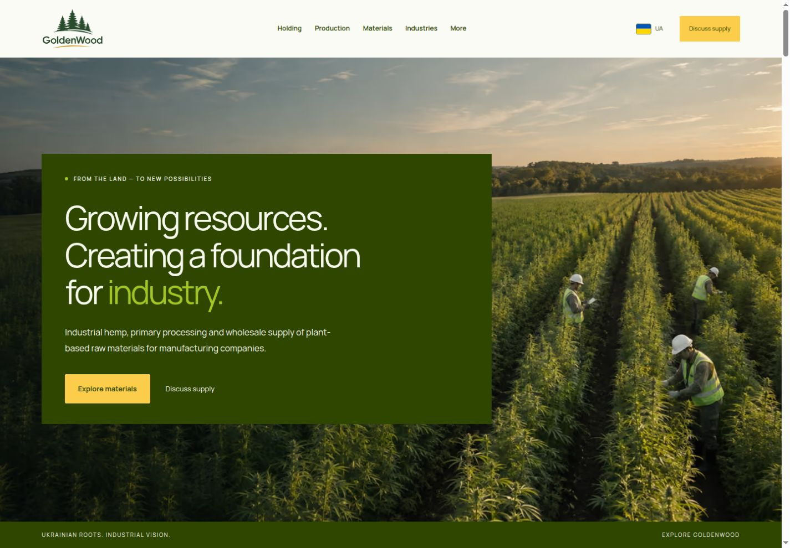
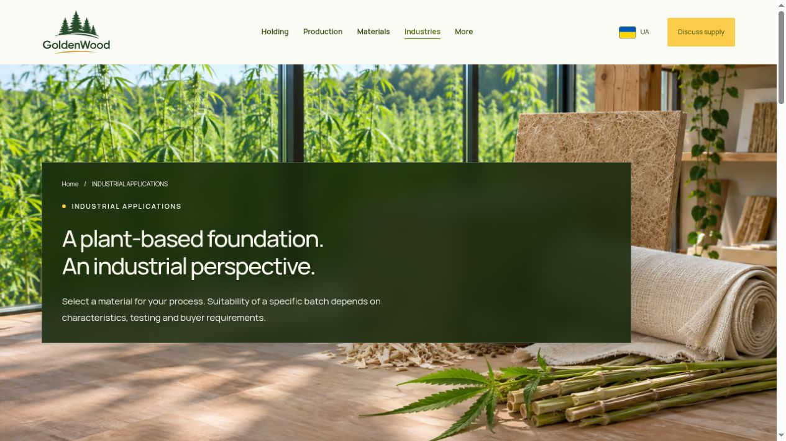
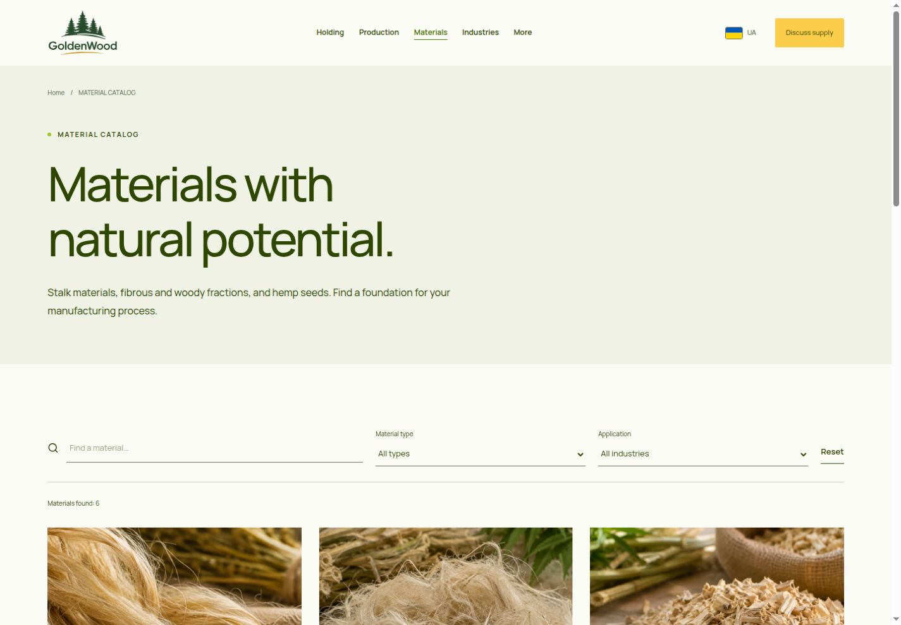
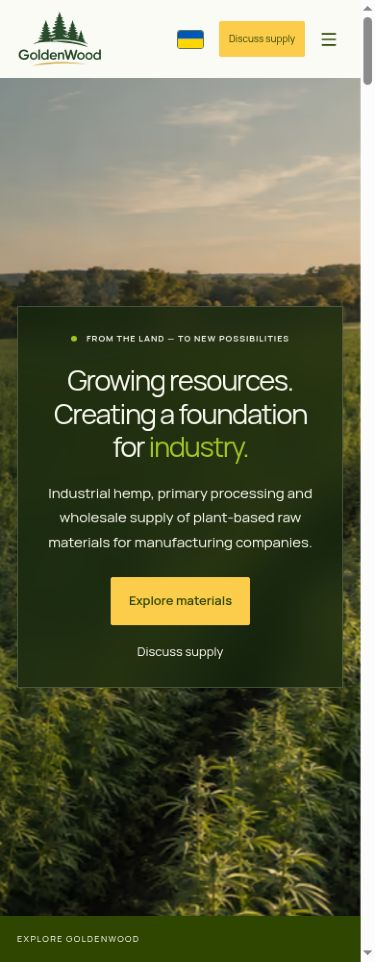

# GoldenWood

**A bilingual B2B website for plant-based industrial materials.**

**Live demo:** [Українська](https://goldenwood-neon.vercel.app/uk) · [English](https://goldenwood-neon.vercel.app/en)

**Source:** [GitHub repository](https://github.com/OlhaKhodakivska/GOLDENWOOD)

GoldenWood is a full-stack portfolio project exploring how an agricultural materials brand can present its production process, help buyers find suitable raw materials, and turn interest into a structured supply inquiry.

Built with **Next.js 16, React 19, TypeScript, and Tailwind CSS 4**, with Ukrainian and English content, a filterable catalog, editorial pages, and a server-validated inquiry API.



> **Project status:** portfolio demonstration. GoldenWood is presented as a concept, not an operating supplier. Contact details are placeholders, images are conceptual visualizations, and the default inquiry form validates submissions without sending them.

## Highlights

- **44 localized routes** across Ukrainian and English, including product and article detail pages.
- **Six materials** with search, material-type filters, and industrial-application filters reflected in the URL.
- **Eight industrial applications**, linked to relevant catalog selections.
- **Six-stage production explorer** with keyboard-accessible tabs.
- **Three knowledge-center articles**, plus an illustrated guide to industrial hemp.
- **B2B inquiry workflow** for supply, samples, technical consultation, and grower partnerships.
- **Responsive navigation**, language switching that preserves the current route and catalog parameters, and explicit scroll handling for page and anchor navigation.
- **Local fonts and optimized images**, reduced-motion support, and a shared forest-green, lime, and sunflower design system.

## Screenshots

Screenshots show the actual production build, rather than design mockups.

### Industrial applications



### Material catalog



### Mobile experience



## Technology stack

| Area                         | Technologies                                                    | Purpose                                                                                                        |
| ---------------------------- | --------------------------------------------------------------- | -------------------------------------------------------------------------------------------------------------- |
| Application                  | Next.js 16.4, React 19.3, React DOM                             | App Router, server-rendered pages, metadata, route handlers, and interactive client components                 |
| Language                     | TypeScript 5, strict mode                                       | Typed content, component contracts, and server/client boundaries                                               |
| Styling                      | Tailwind CSS 4, `@tailwindcss/postcss`, custom CSS              | Shared color tokens, responsive layouts, CSS Grid/Flexbox, typography, focus states, and scroll-driven effects |
| Animation                    | Motion for React                                                | Interactive transitions, filtered content, and reduced-motion-aware animation                                  |
| Forms                        | React Hook Form, Zod, `@hookform/resolvers`                     | Form state and shared client/server validation                                                                 |
| Icons                        | Lucide React                                                    | Consistent interface icons                                                                                     |
| Typography                   | Manrope via Fontsource                                          | Self-hosted WOFF2 files with Latin and Cyrillic subsets                                                        |
| Images                       | Sharp, AVIF, WebP                                               | Image optimization into 640, 1280, and 1536 px variants                                                        |
| API                          | Next.js Route Handlers, Fetch API, Web Crypto                   | Inquiry validation, webhook delivery adapter, timeouts, and hashed rate-limit keys                             |
| Optional live delivery       | HTTPS webhook, Upstash-compatible Redis REST API                | External delivery and distributed rate limiting; not required for the demo                                     |
| Tests                        | Node.js test runner, `node:assert`, `tsx`                       | Unit/API tests and HTTP integration tests                                                                      |
| Code quality                 | ESLint 9, Next.js/React Hooks/JSX accessibility rules, Prettier | Static checks and formatting                                                                                   |
| Deployment                   | Vercel, Node.js 22, npm                                         | Native Next.js hosting and reproducible installs through `package-lock.json`                                   |
| Optional alternative adapter | Vinext, Vite, Cloudflare Vite plugin, Wrangler                  | A separate Sites/Cloudflare build path; not used by the Vercel deployment                                      |

## Architecture

```text
app/
  [locale]/[[...path]]/page.tsx   Localized page resolver and metadata
  api/inquiry/route.ts           Validated inquiry endpoint
  globals.css                   Design system and responsive styles
  layout.tsx                    Root document, icons, scroll coordination
  robots.ts                     Indexing policy
  sitemap.ts                    Localized sitemap
components/                     Page sections and interactive UI
content/
  repository.ts                 Typed bilingual products, articles, and pages
  hemp.ts                       Hemp guide and forest-support content
lib/
  inquiry.ts                    Shared Zod schema
  delivery.ts                   Webhook delivery interface
  rate-limit.ts                 Local/demo and Redis/live limits
public/
  images/                       AVIF/WebP variants
  fonts/                        Local Manrope files
  flags/                        Language-switch icons
assets/originals/               Original conceptual imagery
scripts/                        Optimization, link, and contrast checks
tests/                         Unit/API and HTTP integration tests
docs/screenshots/               Portfolio screenshots
```

Content is separated from presentation through a typed repository layer. Product records are validated with Zod, and a future CMS can be connected behind the repository interface without duplicating page layouts.

The default `/` route redirects to `/uk`. Equivalent English routes live under `/en`. Unknown paths return localized 404 pages.

## Design and interaction

The visual system combines forest green `#2E4600`, grass green `#486B00`, lime `#A2C523`, earth `#7D4427`, and sunflower `#FBCD4B`.

Photographs remain unfiltered. Hero text uses an opaque reading panel for reliable contrast. Other details include full-area card hover states, native disclosure panels, editorial drop caps, an asymmetric article grid, and a reusable corporate favicon derived from the original forest mark.

Accessibility features include skip navigation, semantic landmarks, explicit form labels and errors, keyboard-operated production tabs, mobile-menu focus management, visible focus states, and `prefers-reduced-motion` support. These features do not imply a complete accessibility certification.

## Run locally

Use **Node.js 22** and npm. `.nvmrc` and `package.json` declare the supported major version.

```bash
nvm use
npm ci
cp .env.example .env.local
npm run dev
```

Open [localhost:3000](http://localhost:3000). No paid services or API keys are required for the default demo.

For a production build:

```bash
npm run build
npm start
```

## Environment variables

| Variable                 | Default / requirement                                                                  |
| ------------------------ | -------------------------------------------------------------------------------------- |
| `INQUIRY_MODE`           | `demo`; use `live` only after configuring delivery and distributed limits              |
| `NEXT_PUBLIC_SITE_URL`   | Set to the deployed site's HTTPS origin for canonical URLs, sitemap, and origin checks |
| `SITE_INDEXABLE`         | `false`; the portfolio demo is excluded from search indexing by default                |
| `INQUIRY_WEBHOOK_URL`    | Live mode only: HTTPS delivery endpoint                                                |
| `INQUIRY_WEBHOOK_TOKEN`  | Live mode only: server-side bearer token                                               |
| `RATE_LIMIT_REDIS_URL`   | Live mode only: Upstash-compatible Redis REST endpoint                                 |
| `RATE_LIMIT_REDIS_TOKEN` | Live mode only: server-side Redis token                                                |
| `RATE_LIMIT_TRUST_CF_IP` | `false`; leave disabled on Vercel                                                      |

Never commit `.env.local` or place server credentials in `NEXT_PUBLIC_*` variables. A public site URL is not a secret.

## Inquiry API

`POST /api/inquiry` checks the request origin, JSON content type, streamed body size, honeypot field, rate limit, and shared Zod schema.

- **Demo:** validates the request and clearly reports that it was not delivered.
- **Live:** requires distributed rate limiting and a configured webhook. Success is reported only after the provider returns a successful acknowledgement.
- Requests are limited to **16 KiB** and **five attempts per ten minutes** per rate-limit key. Demo limits are process-local; live limits use Redis.
- Failed delivery preserves the form data so the visitor can retry.
- On Vercel, the current configuration uses a shared limiter key; client-specific limits require a trusted platform-specific IP adapter.

The webhook receives `{ id, inquiry }` with bearer authorization and an idempotency key. Delivery timeout is ten seconds. No database is required by this project.

## Verification

```bash
npm run lint
npm run typecheck
npm test
npm run build
npm run check:contrast
```

Start the production server in another terminal before the HTTP checks:

```bash
npm run start -- --port 3001
```

```bash
TEST_BASE_URL=http://localhost:3001 npm run test:e2e
TEST_BASE_URL=http://localhost:3001 npm run check:links
# Optional: also request external destinations
TEST_BASE_URL=http://localhost:3001 CHECK_EXTERNAL=true npm run check:links
```

The suite includes **12 unit/API tests and 10 HTTP integration scenarios**. Despite the script name `test:e2e`, these are HTTP integration tests, not automated browser interaction tests. The link crawler covers all 44 localized pages and validates internal destinations and fragment IDs. The contrast script checks 30 selected foreground/background pairs; it is not a full accessibility audit.

Reports are written to `validation/`. See [VALIDATION.md](VALIDATION.md) for current scope and limitations.

## Deploy to Vercel

1. Push this repository to GitHub and import it in Vercel.
2. Keep the project root at the repository root and select **Next.js**.
3. Use **Node.js 22**, `npm ci`, and `npm run build`. `vercel.json` declares the framework and commands; leave the output directory at its Next.js default.
4. Set `INQUIRY_MODE=demo`, `SITE_INDEXABLE=false`, and `NEXT_PUBLIC_SITE_URL=https://your-project.vercel.app` for the deployment environment.
5. Deploy. If the final hostname changes, update `NEXT_PUBLIC_SITE_URL` and redeploy.
6. Verify both locales, catalog filters, product-to-inquiry links, and the demo submission response.

The repository also retains an optional `build:sites` adapter for a separate Cloudflare-based workflow. Vercel uses `npm run build`; do not run both build systems concurrently.

## Assets and project scope

The site includes **14 AI-generated conceptual images**, each optimized into six AVIF/WebP variants. Asset descriptions and generation provenance are recorded in `asset-manifest.json`. They illustrate a design concept and do not document operating factories, a vehicle fleet, or commercial production.

The original GoldenWood logo is retained in `public/GoldenWood-original-transparent.svg`. The header version adjusts its view box; the favicon reuses the forest symbol with a contrasting backing.

Forest-support links lead to independent organizations' official websites. The project does not collect donations or claim a partnership. Legal pages and business contact details are demonstration content and require review before any commercial launch.
